# SmartTaskManager – PAI Group 5

**Aufgabenverwaltung mit automatischer Priorisierung**

SmartTaskManager ist eine Web-App zur Aufgabenverwaltung, die Aufgaben automatisch nach Frist und Wichtigkeit sortiert. So sehen Nutzer auf einen Blick, womit sie anfangen sollten.

## Problem

Viele Menschen haben zu viele Aufgaben und wissen nicht, womit sie anfangen sollen. Normale To-do-Listen zeigen nur eine Liste, helfen aber nicht beim Priorisieren. Dadurch werden wichtige Aufgaben vergessen oder zu spät erledigt.

## Lösung

- Aufgaben mit **Frist** und **Wichtigkeit (1–10)** anlegen
- Die App **sortiert automatisch**: je näher die Frist und je höher die Wichtigkeit, desto weiter oben steht die Aufgabe
- Nutzer können die Priorität **manuell überschreiben**, wenn sie mit der Sortierung nicht einverstanden sind
- **Erinnerungen** vor Ablauf der Frist

## Zielgruppe

| Gruppe | Typische Aufgaben |
|---|---|
| Studierende | Abgaben, Prüfungen |
| Berufstätige | Projekte, Termine |
| Privatpersonen | Viele Alltagsaufgaben |

## Wichtigste Anwendungsfälle

1. Aufgabe schnell anlegen
2. Sehen, was heute am wichtigsten ist
3. Aufgabe als erledigt markieren
4. An Fristen erinnert werden

## MVP-Scope

Das MVP enthält nur die Must-Anforderungen:

- Registrierung und Login
- Aufgaben anlegen, bearbeiten, löschen
- Frist und Wichtigkeit angeben
- Automatische Sortierung
- Aufgaben abhaken

Details siehe [docs/requirements.md](docs/requirements.md).

## Projektphasen

| Phase | Inhalt | Status |
|---|---|---|
| Phase 1 | Anforderungsanalyse: Problem, Zielgruppe, User Stories, Anforderungen, MoSCoW, MVP-Scope, Prüfung auf Widersprüche | ✅ abgeschlossen |
| Architektur | Architekturvarianten, Technologieauswahl, C4-Diagramme, Datenmodell, API-Design, ADRs, Hosting-Vergleich | 📝 Vorschlag, Team-Review offen |
| Phase 2 | Continuous Deployment: GitHub → CD → Vercel | ⏳ geplant |

## Dokumentation

| Dokument | Inhalt |
|---|---|
| [README.md](README.md) | Projektüberblick (dieses Dokument) |
| [docs/requirements.md](docs/requirements.md) | User Stories, funktionale und nichtfunktionale Anforderungen, Priorisierung, MVP, Widersprüche und Unklarheiten |
| [docs/architecture.md](docs/architecture.md) | Architekturvarianten, gewählte Architektur, Technologien, C4-Diagramme, Datenmodell, API-Design, kritische Prüfung |
| [docs/adr/](docs/adr/README.md) | Architecture Decision Records (ADR-0001 bis ADR-0005) |
| [docs/hosting.md](docs/hosting.md) | Vergleich der Hosting-Möglichkeiten (Kosten, Aufwand, DSGVO) |
| [docs/diagrams/](docs/diagrams/) | Architekturdiagramme (Mermaid-Quellen und SVG) |
| [docs/ai-usage.md](docs/ai-usage.md) | Einsatz von AI in Anforderungsanalyse und Architektur, Reflexion |

## Architektur auf einen Blick

Next.js-Anwendung (UI + REST-API) auf Vercel, PostgreSQL bei Neon (Frankfurt), täglicher Cron-Job für Erinnerungen. Details siehe [docs/architecture.md](docs/architecture.md).

## Team

PAISE – Gruppe 5
