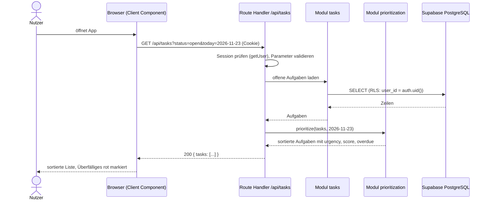

# API-Design – SmartTaskManager

> Stand: 23.11.2026. REST-API über Next.js Route Handlers, siehe [architecture.md](architecture.md). Datenmodell: [data-model.md](data-model.md).

## Grundsätze

- **Format:** JSON, Felder in `camelCase`. Datumswerte als ISO 8601: Fristen als `YYYY-MM-DD`, Zeitpunkte in UTC als `2026-11-23T14:05:00Z` (die Datenbank liefert `+00:00`; die API vereinheitlicht auf `Z`).
- **Authentifizierung:** Supabase Auth über `@supabase/ssr`, Session in Cookies.
  - Die Cookies werden **explizit** mit `httpOnly: true`, `secure: true`, `sameSite: 'lax'` konfiguriert. Standardmäßig wären sie für JavaScript lesbar, weil ein Browser-Client sie bräuchte – den gibt es bei uns nicht (der Browser spricht nie direkt mit Supabase). Ein Browser-Client (`createBrowserClient`) wird im Code nicht verwendet.
  - Eine Next.js-Middleware erneuert abgelaufene Zugriffstoken bei jeder Anfrage. Ohne sie liefe die Session nach etwa einer Stunde ab.
  - Der Nutzer wird mit `getUser()` ermittelt (prüft das Token beim Auth-Server), nicht mit `getSession()` (liest nur das Cookie, ungeprüft).
  - Alle Endpunkte außer Registrierung, Login und Passwort-Reset-Anforderung erfordern eine gültige Session, sonst `401`.
- **Nur eigene Daten:** Der Server ermittelt den Nutzer aus der Session, nie aus dem Request-Body. Fremde Aufgaben liefern `404` (nicht `403`), damit nicht erkennbar ist, ob eine ID existiert. Wichtig für die Umsetzung: Unter RLS liefern `UPDATE`/`DELETE` auf fremde Zeilen keinen Fehler, sondern betreffen einfach 0 Zeilen. Der Server fragt deshalb die betroffene Zeile zurück (`.select().maybeSingle()`) und antwortet bei `null` mit `404`. Eine `{id}`, die keine gültige UUID ist, wird ebenfalls mit `404` beantwortet.
- **Validierung:** Jeder Request-Body und Query-Parameter wird serverseitig mit Zod geprüft. Schemas sind `strict`: unbekannte Felder führen zu `400`. Die Datenbank prüft zusätzlich (siehe data-model.md).
- **CSRF-Schutz:** Da die Session in Cookies liegt, könnte eine fremde Webseite Anfragen im Namen des Nutzers auslösen. Schutz in zwei Schichten:
  1. Cookies mit `SameSite=Lax` – werden bei Anfragen von fremden Seiten (außer einfacher Navigation) nicht mitgeschickt.
  2. `POST`, `PATCH` und `DELETE` mit Body verlangen `Content-Type: application/json` (sonst `415`). Einfache HTML-Formulare fremder Seiten können diesen Typ nicht senden. Auch `PATCH` und `DELETE` können sie nicht auslösen; Skripte fremder Seiten blockiert der Browser, weil die API keine CORS-Freigabe erteilt.
- **Kein Caching:** Alle Antworten mit Nutzerdaten tragen `Cache-Control: private, no-store`.
- **Lokales Datum des Nutzers:** Die Priorisierung hängt vom heutigen Datum des Nutzers ab. Der Browser schickt sein lokales Datum als Parameter `today` mit ([ADR-003](adr/003-lokales-datum-als-api-parameter.md)). Siehe [Umsetzung im Client](#umsetzung-im-client).

## Übersicht

| Methode | Pfad | Zweck | Anforderung | MVP |
|---|---|---|---|---|
| `POST` | `/api/auth/register` | Konto anlegen und anmelden | F1, US1 | ja |
| `POST` | `/api/auth/login` | Anmelden | F1, US1 | ja |
| `POST` | `/api/auth/logout` | Abmelden | F1 | ja |
| `GET` | `/api/tasks` | Offene (sortiert) oder erledigte Aufgaben abrufen | F4, F5, US5, US6 | ja |
| `POST` | `/api/tasks` | Aufgabe anlegen | F2, F3, US2–US4 | ja |
| `PATCH` | `/api/tasks/{id}` | Aufgabe ändern, Frist entfernen, abhaken, Abhaken rückgängig | F2, F3, F5, US3, US4, US6, US7 | ja |
| `DELETE` | `/api/tasks/{id}` | Aufgabe löschen | F2, US7 | ja |
| `DELETE` | `/api/account` | Konto mit allen Aufgaben löschen (mit Passwort) | F9, US11 | ja |
| `POST` | `/api/auth/password-reset` | Link zum Zurücksetzen anfordern | F10, US12 | nein (Should) |
| `POST` | `/api/auth/password` | Neues Passwort setzen (mit Session aus dem Link) | F10, US12 | nein (Should) |

Zu F10 siehe [Ablauf Passwort zurücksetzen](#ablauf-passwort-zurücksetzen-should-f10).

## Datenobjekt `Task`

```json
{
  "id": "3f0c2a4e-8b1d-4c6e-9a7f-2d5b1e8c9a10",
  "title": "Prüfung lernen",
  "dueDate": "2026-11-26",
  "importance": 9,
  "completedAt": null,
  "createdAt": "2026-11-20T09:12:00Z",
  "urgency": 7,
  "score": 8.2,
  "overdue": false
}
```

| Feld | Typ | Beschreibung |
|---|---|---|
| `id` | string (UUID) | |
| `title` | string | 1–200 Zeichen, ohne führende/nachfolgende Leerzeichen |
| `dueDate` | string \| null | `YYYY-MM-DD` oder `null` (keine Frist) |
| `importance` | integer | 1–10 |
| `completedAt` | string \| null | `null` = offen |
| `createdAt` | string | |
| `urgency` | integer | Dringlichkeit D (1–10), **berechnet** |
| `score` | number | (6 × Wichtigkeit + 4 × D) / 10, eine Nachkommastelle, **berechnet**. Sortiert wird intern mit der ganzen Zahl 6 × Wichtigkeit + 4 × D, damit Rundungsfehler von Kommazahlen den Gleichstand-Vergleich nicht verfälschen (requirements.md Kapitel 7). |
| `overdue` | boolean | Frist liegt vor `today`, **berechnet** |

Die berechneten Felder gibt es nur in der offenen Liste (`GET /api/tasks?status=open`), weil nur dort `today` bekannt ist. In allen anderen Antworten (erledigte Liste, `POST`, `PATCH`) fehlen sie – sie werden weggelassen, nicht als `null` gesendet.

Ab F6 kommt `dueTomorrow` (boolean, berechnet) hinzu, ab F8 `pinned` (boolean).

## Fehlerformat

Alle Fehler haben dieselbe Form:

```json
{
  "error": {
    "code": "VALIDATION_ERROR",
    "message": "Eingaben sind ungültig.",
    "fields": { "title": "Titel darf nicht leer sein." }
  }
}
```

| HTTP-Status | `code` | Wann |
|---|---|---|
| 400 | `VALIDATION_ERROR` | Ungültiger Body oder Parameter (`fields` nennt die Felder) |
| 401 | `UNAUTHORIZED` | Keine oder abgelaufene Session |
| 401 | `INVALID_CREDENTIALS` | Falsche E-Mail oder falsches Passwort beim Login (ohne Hinweis, welches falsch war) oder falsches Passwort beim Konto-Löschen |
| 404 | `NOT_FOUND` | Aufgabe existiert nicht, gehört einem anderen Nutzer oder die ID ist keine gültige UUID |
| 409 | `EMAIL_TAKEN` | Registrierung mit bereits verwendeter E-Mail |
| 415 | `UNSUPPORTED_MEDIA_TYPE` | Body ohne `Content-Type: application/json` |
| 429 | `RATE_LIMITED` | Zu viele Anfragen (z. B. Login-Versuche; Limit des Auth-Dienstes) |
| 500 | `INTERNAL_ERROR` | Unerwarteter Fehler (keine Details nach außen) |

## Endpunkte

### `POST /api/auth/register`

Request:

```json
{ "email": "anna@example.com", "password": "geheim123" }
```

- `email`: gültige E-Mail-Adresse
- `password`: mindestens 8 Zeichen. Dieselbe Mindestlänge ist in den Supabase-Auth-Einstellungen gesetzt (Standard dort: 6), damit API und Auth-Dienst gleich prüfen – auch beim späteren Setzen eines neuen Passworts (F10).

Antwort `201`: `{ "user": { "id": "…", "email": "anna@example.com" } }` und Session-Cookie. Keine E-Mail-Bestätigung (requirements.md #15).
Fehler: `400`, `409`, `415`, `429`.

**Bewusst in Kauf genommen:** `409 EMAIL_TAKEN` verrät, ob eine E-Mail-Adresse registriert ist. Die Alternative – immer gleich antworten und den Inhaber per E-Mail informieren – braucht E-Mail-Versand, den das MVP nicht hat (requirements.md #15). Für eine Aufgaben-App ohne sensible Inhalte ist das vertretbar. Beim Passwort-Reset (F10) wird die Information dagegen nicht preisgegeben, weil dort der E-Mail-Versand ohnehin vorhanden ist.

### `POST /api/auth/login`

Request wie bei der Registrierung. Antwort `200`: `{ "user": { … } }` und Session-Cookie.
Fehler: `400`, `401 INVALID_CREDENTIALS`, `415`, `429`.

### `POST /api/auth/logout`

Kein Body. Antwort `204`, Session-Cookies werden gelöscht.
Fehler: `401`.

### `GET /api/tasks`

| Parameter | Pflicht | Werte |
|---|---|---|
| `status` | nein | `open` (Standard) oder `done` |
| `today` | bei `status=open` ja | lokales Datum des Nutzers, `YYYY-MM-DD` |

Antwort `200`:

```json
{ "tasks": [ { …Task… }, { …Task… } ] }
```

- `status=open`: nur Aufgaben mit `completedAt = null`, sortiert nach der Priorisierungsregel (requirements.md Kapitel 7), mit `urgency`, `score`, `overdue`.
- `status=done`: nur erledigte Aufgaben, neueste zuerst (`completedAt` absteigend), ohne berechnete Felder.

Fehler: `400` (z. B. `today` fehlt oder ist kein gültiges Datum), `401`.

### `POST /api/tasks`

Request:

```json
{ "title": "Prüfung lernen", "dueDate": "2026-11-26", "importance": 9 }
```

- `title`: Pflicht; wird getrimmt gespeichert; danach 1–200 Zeichen
- `dueDate`: optional, `YYYY-MM-DD` oder `null`
- `importance`: optional, ganze Zahl 1–10, Standard 5

Antwort `201`: die angelegte Aufgabe ohne berechnete Felder. Der Client lädt danach die sortierte Liste neu (US5: „sofort neu sortiert“).
Fehler: `400`, `401`, `415`.

### `PATCH /api/tasks/{id}`

Nur übergebene Felder werden geändert:

```json
{ "title": "Prüfung lernen (Kapitel 1–4)", "dueDate": null, "importance": 8, "completed": true }
```

| Feld | Erlaubte Werte | Bedeutung |
|---|---|---|
| `title` | string (wird getrimmt, 1–200 Zeichen) | neuer Titel; `null` → `400` |
| `dueDate` | `YYYY-MM-DD` oder `null` | `null` entfernt die Frist (US3) |
| `importance` | ganze Zahl 1–10 | `null` → `400` |
| `completed` | `true` / `false` | `true` setzt `completedAt` auf jetzt, `false` setzt es auf `null` (Abhaken rückgängig, US6); `null` → `400` |
| `pinned` (ab F8) | `true` / `false` | anpinnen / lösen |

- Ein fehlendes Feld bleibt unverändert; nur `dueDate` darf `null` sein.
- Ein leerer Body `{}` oder unbekannte Felder führen zu `400`.

Antwort `200`: die geänderte Aufgabe ohne berechnete Felder.
Fehler: `400`, `401`, `404`, `415`.

### `DELETE /api/tasks/{id}`

Antwort `204`. Die Bestätigung vor dem Löschen (US7) erfolgt in der Oberfläche.
Fehler: `401`, `404`.

### `DELETE /api/account`

Request:

```json
{ "password": "geheim123" }
```

1. Der Server prüft das Passwort: Anmeldeversuch mit der E-Mail aus der Session und dem übergebenen Passwort. Falsch → `401 INVALID_CREDENTIALS`. So kann niemand an einem kurz unbeaufsichtigten, angemeldeten Rechner das Konto löschen (US11).
2. Das Konto wird über die Supabase Admin-API gelöscht; alle Aufgaben werden per `ON DELETE CASCADE` mitgelöscht.
3. Die Session-Cookies werden gelöscht.

Antwort `204`.
Fehler: `400`, `401`, `415`, `429` (Passwortprüfung zählt als Anmeldeversuch).

Sicherheit: Dieser Endpunkt verwendet als einziger den geheimen Admin-Schlüssel (Service-Role- bzw. Secret-Key, Risiko R6 in architecture.md) – über einen **eigenen** Supabase-Client ohne Cookies (`persistSession: false`, `autoRefreshToken: false`). Würde man den Admin-Schlüssel mit dem Cookie-Client kombinieren, könnte das Token des Nutzers den Admin-Schlüssel überschreiben. Die zu löschende Nutzer-ID kommt ausschließlich aus der Session.

### Ablauf Passwort zurücksetzen (Should, F10)

Nicht Teil des MVP; die Details werden bei der Umsetzung von F10 festgelegt. Der Nutzer fordert mit seiner E-Mail einen Link an (Antwort immer `202`, damit nicht erkennbar ist, welche Adressen registriert sind). Der Link führt in die App, dort setzt der Nutzer ein neues Passwort (mindestens 8 Zeichen, Antwort `204`). Link und Prüfung übernimmt Supabase Auth; nötig ist ein eigener SMTP-Dienst (siehe hosting.md).

## Umsetzung im Client

- Die Seite mit der offenen Liste ist eine **Client Component**, die `/api/tasks` im Browser aufruft. Nur der Browser kennt das lokale Datum; eine vom Server gerenderte Seite (Server Component) kennt es nicht.
- `today` wird mit `new Date().toLocaleDateString('en-CA')` gebildet – das liefert `YYYY-MM-DD` in **lokaler** Zeit. Nicht `toISOString().slice(0, 10)` verwenden: das liefert das UTC-Datum und würde das Zeitzonenproblem (R1) wieder einführen.
- Der Server rechnet die Tage bis zur Frist rein mit Kalenderdaten (ohne Uhrzeit), damit Sommer-/Winterzeit-Umstellungen keine Fehler um einen Tag verursachen.
- Während des Ladens zeigt die Liste einen Platzhalter (Skeleton), damit die Seite sofort reagiert (NF2).

## Warum `today` als Parameter?

Kurzfassung der Abwägung, ausführlich in [ADR-003](adr/003-lokales-datum-als-api-parameter.md):

| Option | Vorteil | Nachteil |
|---|---|---|
| **Browser schickt `today` mit (gewählt)** | Einfach; Sortierlogik bleibt auf dem Server; Tests können ein festes Datum übergeben und sind damit reproduzierbar | Nutzer könnte ein falsches Datum schicken – betrifft aber nur seine eigene Ansicht |
| Server rechnet in UTC | Am einfachsten | Zwischen 0 und 1 bzw. 2 Uhr falsche Sortierung (verletzt US5) |
| Zeitzone im Nutzerkonto speichern | Server kennt das Datum selbst | Zusätzliches Datum pro Nutzer (NF5), falsch auf Reisen |
| Sortierung nur im Browser | Kein Parameter nötig | API liefert unsortierte Daten; Sortierung nicht über HTTP-Tests prüfbar |

## Beispielablauf: offene Liste laden


