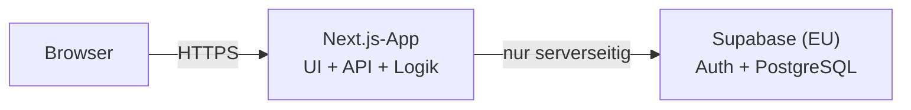
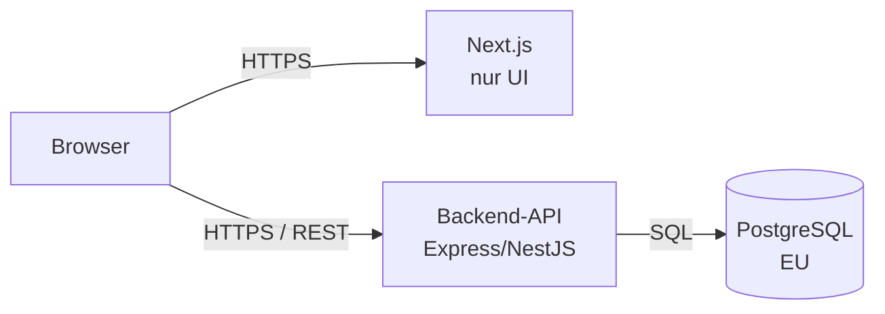
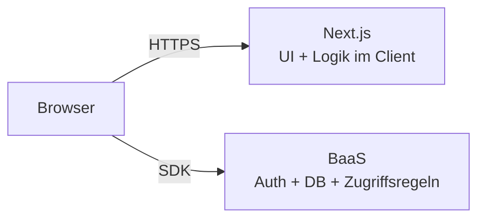
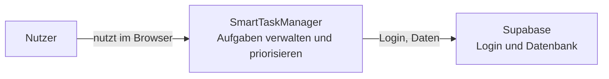
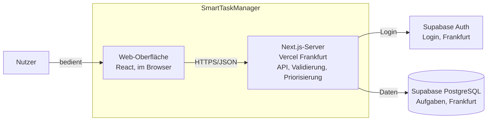
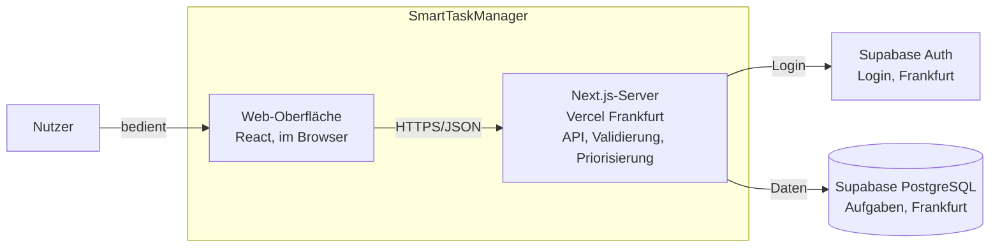
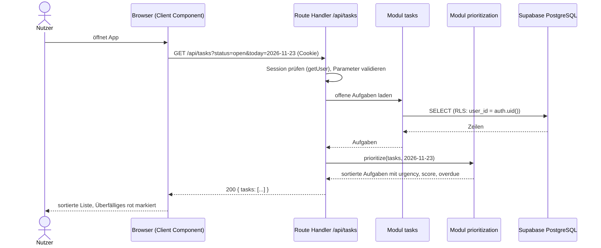

# Architektur – SmartTaskManager

> Stand: 23.11.2026 – Variante A vom Team bestätigt. Entscheidungen sind als ADRs in [adr/](adr/) dokumentiert, der Hosting-Vergleich in [hosting.md](hosting.md).

## Inhalt

1. [Ausgangslage](#1-ausgangslage)
2. [Architekturvarianten](#2-architekturvarianten)
3. [Vergleich](#3-vergleich)
4. [Entscheidung](#4-entscheidung)
5. [Technologieauswahl](#5-technologieauswahl)
6. [Architekturdiagramm (C4)](#6-architekturdiagramm-c4)
7. [Datenmodell und API](#7-datenmodell-und-api)
8. [Risiken](#8-risiken)
9. [Weitere Dokumente](#9-weitere-dokumente)

---

## 1. Ausgangslage

### Architekturrelevante Anforderungen

Nicht jede Anforderung beeinflusst die Architektur. Diese hier schon (Details in [requirements.md](requirements.md)):

| Anforderung | Auswirkung auf die Architektur |
|---|---|
| F1 Registrierung und Login, NF3 Passwörter gehasht | Authentifizierung mit sicherem Passwort-Hashing und Sessions nötig |
| F2, F3, F5 Aufgaben verwalten | Einfaches CRUD auf einer relationalen Struktur (Nutzer 1 : n Aufgaben) |
| F4 Priorisierungsregel | Reine Berechnungslogik, muss isoliert testbar sein; hängt vom **lokalen Datum** des Nutzers ab |
| F9 Konto löschen, NF5 DSGVO | Löschen muss alle Daten eines Nutzers vollständig entfernen; Datenbank muss in der EU liegen |
| NF2 Liste lädt in unter 2 Sekunden | Kurzer Weg zwischen Server und Datenbank; keine unnötigen Netzwerk-Hops |
| NF4 Web-App in aktuellen Browsern | Browserbasierte Web-App, keine native App |
| F6 Erinnerung in der App (Should) | Wird beim Öffnen der App berechnet – **kein** Hintergrundjob, kein Mail-Dienst nötig |

Wichtig für den Scope: Das MVP braucht **keine** Hintergrundprozesse, keine Echtzeit-Funktionen, keinen Datei-Upload und keine externen APIs außer der Datenbank.

### Rahmenbedingungen

- **Team-Know-how:** Das Team kennt Next.js und Vercel; im Team gibt es Erfahrung mit Supabase aus mehreren Projekten. Technologien außerhalb davon bedeuten Einarbeitungszeit.
- **Zeit:** Ein Semester, kleines Team. Weniger bewegliche Teile sind besser.
- **Kosten:** Ziel ist ein Betrieb im kostenlosen Rahmen (Vergleich in `docs/hosting.md`).
- **Team-Präferenz Vercel:** Vercel ist Favorit, wird aber in `docs/hosting.md` mit Alternativen verglichen.

## 2. Architekturvarianten

Alle Varianten verwenden Next.js für die Oberfläche, weil das Team es kennt. Sie unterscheiden sich darin, **wo die Geschäftslogik liegt** und **wie viele Systeme** betrieben werden.

### Variante A – Modularer Monolith mit Next.js (Full-Stack)

Eine Next.js-Anwendung enthält Oberfläche **und** Backend. Das Backend besteht aus Route Handlers (REST-API unter `/api/...`) bzw. serverseitigem Code. Die Logik ist intern in Module getrennt (Auth, Aufgaben, Priorisierung, Konto). Daten liegen in einer verwalteten PostgreSQL-Datenbank; Login übernimmt ein verwalteter Auth-Dienst (gewählt: Supabase, siehe Kapitel 5).

- **Eine** Codebasis, **ein** Deployment, **eine** Sprache (TypeScript).
- Die Priorisierungsregel ist ein eigenes Modul (reine Funktion) und unabhängig von UI und Datenbank testbar.

### Variante B – Getrenntes Frontend und Backend

Next.js liefert nur die Oberfläche. Ein eigener Backend-Dienst (z. B. Node.js mit Express oder NestJS) stellt eine REST-API bereit und spricht mit der Datenbank.

- Klare technische Trennung, API unabhängig von der Oberfläche.
- Aber: **zwei** Codebasen, **zwei** Deployments (z. B. Vercel + Render/Railway), CORS-Konfiguration, gemeinsame Typen müssen synchron gehalten werden.

### Variante C – Next.js mit Backend-as-a-Service (z. B. Supabase)

Die Oberfläche spricht direkt mit einem BaaS-Anbieter, der Datenbank, Authentifizierung und Zugriffsregeln (Row Level Security) bereitstellt. Eigener Backend-Code entfällt weitgehend.

- Sehr wenig eigener Code für Login und Datenzugriff; ein verbreiteter und von Supabase vorgesehener Ansatz.
- Aber: Sicherheit hängt **allein** an korrekt geschriebenen Zugriffsregeln in SQL; starke Bindung an den Anbieter.
- Ganz ohne Server geht es auch hier nicht: Konto löschen (F9) braucht den Admin-Schlüssel von Supabase, der nie in den Browser darf. Dafür wäre zusätzlich eine Supabase Edge Function nötig – Logik verteilt sich dann auf Browser, Datenbankregeln und Edge Function.

### Bewusst verworfen: Microservices

Getrennte Dienste für Auth, Aufgaben und Erinnerungen mit eigener Datenbank und Message Queue. Für eine App mit einer Kern-Entität (Aufgabe), einem kleinen Team und ohne Skalierungsanforderung bringt das nur Nachteile: mehr Deployments, verteilte Fehler, höhere Kosten. Wird nicht weiter betrachtet.

## 3. Vergleich

Bewertung: ++ sehr gut, + gut, o neutral, − schlecht, − − sehr schlecht

| Kriterium | Bezug | A: Monolith | B: Getrennt | C: BaaS |
|---|---|---|---|---|
| Umsetzungsaufwand im Semester | Scope | ++ | − | + |
| Passt zum Team-Know-how (Next.js, Vercel, Supabase) | Rahmen | ++ | o | + |
| Sicheres Login, Passwort-Hashing | F1, NF3 | ++ (mit Supabase Auth) | ++ (Supabase Auth auch hier nutzbar) | ++ (eingebaut) |
| Priorisierungsregel isoliert testbar | F4, US5 | ++ | ++ | ++ (reine Funktion, auch im Client testbar) |
| Konto löschen ohne Admin-Schlüssel im Browser | F9, NF5 | ++ (Server-Code vorhanden) | ++ | − (zusätzliche Edge Function nötig) |
| Explizite API, über HTTP-Tests prüfbar | Testbarkeit | ++ | ++ | − (Zugriff direkt über das Supabase-SDK) |
| Ladezeit unter 2 Sekunden | NF2 | + (Weg Browser → Vercel → Supabase) | o (Weg Browser → Backend-Host → Datenbank, zweiter Host evtl. mit Schlafmodus) | ++ (direkter Weg Browser → Supabase) |
| Betrieb: Anzahl Deployments | Wartbarkeit | ++ (1) | − (2) | + (1 + Anbieter) |
| Kosten im kostenlosen Rahmen | Rahmen | + | o (zweiter Host nötig) | + |
| Anbieterbindung | Wartbarkeit | − (Login, RLS und Datenzugriff an Supabase gebunden; Logik in eigenem Code) | o (Backend frei wählbar) | − − (zusätzlich Logik in Datenbankregeln und Edge Functions) |
| Erweiterbarkeit (z. B. E-Mail-Erinnerung) | F6-Ausbau | + (Cron-Job + Mail-Dienst) | + | o |

Die Kriterien sind nicht gleich gewichtet. Ausschlaggebend für ein Semesterprojekt sind **Umsetzungsaufwand**, **Team-Know-how** und **Sicherheit**; bei der Ladezeit liegen alle Varianten voraussichtlich unter 2 Sekunden, bei der Anbieterbindung schneidet A schlechter ab als B. B scheitert am Aufwand (zwei Systeme), C an der Sicherheit (eine Schutzschicht) und daran, dass für Konto löschen trotzdem Server-Code nötig ist.

## 4. Entscheidung

**Gewählt: Variante A – Modularer Monolith mit Next.js, Supabase als Datenbank und Auth-Dienst.** (Vom Team bestätigt am 23.11.2026.)

**Abgrenzung zu Variante C:** Auch Variante A nutzt Supabase – aber nur als Infrastruktur. Der Browser spricht **nie direkt** mit der Datenbank; jeder Zugriff läuft über die eigene API auf dem Server, wo Eingaben geprüft und die Geschäftslogik ausgeführt wird. Zugriffsregeln in der Datenbank (Row Level Security) sind eine **zweite** Schutzschicht, nicht die einzige.

Begründung:

1. **Einfachste Lösung, die alle Anforderungen erfüllt.** Das MVP ist im Kern CRUD plus eine Sortierregel. Dafür braucht es keinen zweiten Dienst.
2. **Passt zum Team.** Next.js und Vercel sind bekannt, es kommt keine zweite Sprache oder Plattform dazu.
3. **Gut testbar.** Die Priorisierungsregel ist ein eigenes Modul mit einer reinen Funktion und kann mit den Beispieldaten aus requirements.md Kapitel 7 als Unit-Test geprüft werden.
4. **Ein Deployment.** Kein CORS, keine doppelte Typdefinition, kein zweiter Host.

Bewusst in Kauf genommene Nachteile:

- Oberfläche und Backend sind in einem Projekt gekoppelt. Gegenmaßnahme: eine explizite REST-API unter `/api/...` statt reiner Server Actions – sie ist dokumentiert und lässt sich mit HTTP-Tests direkt prüfen, auch mit einem festen Datum `today` (ADR-003).
- Abhängigkeit von Supabase für Login und Datenbank. Gegenmaßnahme: Die Daten liegen in normalem PostgreSQL und lassen sich exportieren; Supabase-Zugriffe sind auf die Module `auth`, `tasks` und `account` beschränkt.

Variante C ist die stärkste Alternative und wäre für diese App ebenfalls umsetzbar, zumal im Team Supabase-Erfahrung vorhanden ist. Wir haben uns trotzdem für A entschieden:

1. **Server-Code wird ohnehin gebraucht.** Konto löschen (F9) erfordert den Admin-Schlüssel, der nur auf einem Server liegen darf. Bei C käme dafür eine Edge Function hinzu – dann lieber eine einheitliche API an einem Ort.
2. **Zwei Schutzschichten statt einer.** Bei A prüft der Server Session und Eingaben, RLS schützt zusätzlich. Bei C führt ein einziger Fehler in einer Zugriffsregel direkt zu einem Datenleck.
3. **Explizite REST-API.** Sie ist dokumentiert ([api.md](api.md)) und mit HTTP-Tests prüfbar.
4. **Kein Mehraufwand im Betrieb.** Der Server-Teil von Next.js läuft auf Vercel mit; es kommt kein zusätzliches System hinzu.

Kein Argument gegen C ist dagegen die Manipulierbarkeit der Sortierung im Browser: Ein Nutzer könnte damit nur seine eigene Ansicht verändern (vgl. [ADR-003](adr/003-lokales-datum-als-api-parameter.md)).

### Modulstruktur

| Modul | Verantwortung |
|---|---|
| `auth` | Registrierung, Login, Logout, Session-Prüfung (über Supabase Auth) |
| `tasks` | Aufgaben anlegen, lesen, ändern, löschen, abhaken |
| `prioritization` | Reine Funktion: Score berechnen und Liste sortieren – keine Abhängigkeit zu DB oder UI |
| `account` | Konto mit allen Daten löschen (Supabase Admin-API; Aufgaben werden per Fremdschlüssel mitgelöscht) |
| `ui` | Seiten und Komponenten (Liste, Formular, Ansicht „Erledigt“) |

Regel: Module greifen nur über ihre öffentliche Schnittstelle aufeinander zu; nur `tasks`, `auth` und `account` sprechen mit Supabase.

## 5. Technologieauswahl

| Komponente | Wahl | Begründung | Alternativen | Status |
|---|---|---|---|---|
| Sprache | TypeScript | Eine Sprache für UI und Backend; Typen fangen Fehler früh | JavaScript | entschieden |
| Framework | Next.js (App Router) | Team-Know-how; UI und API in einem Projekt | Remix, SvelteKit | entschieden ([ADR-001](adr/001-modularer-monolith-nextjs.md)) |
| API-Stil | REST über Route Handlers | Endpunkte lassen sich mit HTTP-Tests direkt prüfen (inkl. Sortierung mit festem `today`); klare Grenze zwischen UI und Logik | Server Actions (keine eigenständig aufrufbaren Endpunkte) | entschieden ([ADR-001](adr/001-modularer-monolith-nextjs.md)) |
| Datenbank | PostgreSQL bei Supabase, EU-Region | Relationale Daten (Nutzer 1 : n Aufgaben); EU-Region erfüllt NF5; Erfahrung im Team; serverlose Umgebung hat kein dauerhaftes Dateisystem, daher kein SQLite | Neon (nur Datenbank, ohne Login), SQLite/libSQL (Turso), MongoDB | entschieden ([ADR-002](adr/002-supabase-fuer-datenbank-und-auth.md)) |
| Authentifizierung | Supabase Auth (E-Mail/Passwort) | Im selben Dienst und derselben EU-Region wie die Datenbank; Passwort-Hashing eingebaut (NF3); Session-Cookies serverseitig über `@supabase/ssr` (explizit HTTP-only), Token-Erneuerung per Middleware; Erfahrung im Team | Auth.js, Better Auth (mehr eigener Code), Clerk (Nutzerdaten bei weiterem Drittanbieter, NF5) | entschieden ([ADR-002](adr/002-supabase-fuer-datenbank-und-auth.md)) |
| Datenbankzugriff | `supabase-js` serverseitig, mit der Session des Nutzers | Zugriffsregeln (RLS) greifen als zweite Schutzschicht; Erfahrung im Team; Zugriff über HTTP statt direkter DB-Verbindungen (entschärft R2) | Prisma, Drizzle (verbinden sich als DB-Besitzer und umgehen RLS) | entschieden |
| Migrationen | Supabase CLI (SQL-Migrationsdateien im Repository) | Schema versioniert und reproduzierbar | Änderungen im Dashboard (nicht nachvollziehbar) | entschieden |
| Validierung | Zod (Schemas für Request-Body und Parameter) | Eine Schema-Definition liefert Prüfung und TypeScript-Typen | manuelle Prüfungen | entschieden |
| Tests | Vitest (Unit); Playwright (Ende-zu-Ende) optional | Unit-Tests für Priorisierungsregel; E2E für den Demo-Ablauf aus mvp.md nur, wenn Zeit bleibt | Jest, Cypress | entschieden |
| Hosting | Vercel Hobby (Region Frankfurt) + Supabase Free (Region Frankfurt) | Kostenlos, Next.js nativ, App und Datenbank in derselben EU-Region, automatisches Deployment aus GitHub | Netlify, Render, Railway, Hetzner – siehe [hosting.md](hosting.md) | entschieden ([ADR-004](adr/004-hosting-vercel-und-supabase-eu.md)) |

ADRs: [001 Architekturstil](adr/001-modularer-monolith-nextjs.md), [002 Supabase](adr/002-supabase-fuer-datenbank-und-auth.md), [003 lokales Datum](adr/003-lokales-datum-als-api-parameter.md), [004 Hosting](adr/004-hosting-vercel-und-supabase-eu.md).

## 6. Architekturdiagramm (C4)

Die Diagramme folgen dem [C4-Modell](https://c4model.com/): Kontext (Ebene 1) und Container (Ebene 2). Ebene 3 (Komponenten) entfällt; die Module des Servers beschreibt die [Modulstruktur in Kapitel 4](#modulstruktur).

### Ebene 1 – Systemkontext

### Ebene 2 – Container

Mermaid-Quelltext

Die PNG-Bilder in [diagrams/](diagrams/) sind aus dem Mermaid-Quelltext erzeugt; bei Änderungen am Diagramm müssen sie neu erzeugt werden.

## 7. Datenmodell und API

- **Datenmodell:** [data-model.md](data-model.md) – Tabelle `tasks`, ER-Diagramm, SQL-Migration mit Zugriffsregeln
- **API-Design:** [api.md](api.md) – REST-Endpunkte, Datenformate, Fehlerformat, Ablauf „Liste laden“

**Ablauf „Offene Liste laden“** (Quelltext des Diagramms in [api.md](api.md#beispielablauf-offene-liste-laden)):

## 8. Risiken

| # | Risiko | Auswirkung | Gegenmaßnahme |
|---|---|---|---|
| R1 | **Zeitzone:** Die Dringlichkeit hängt vom lokalen Datum des Nutzers ab. Server laufen meist in UTC. In Mitteleuropa (UTC+1, Sommerzeit UTC+2) hätte der Server zwischen Mitternacht und 1 bzw. 2 Uhr noch das Datum vom Vortag. | Falsche Sortierung (verletzt US5) | **Gelöst:** Der Browser schickt sein lokales Datum als Parameter `today` mit, der Server sortiert damit ([ADR-003](adr/003-lokales-datum-als-api-parameter.md)). |
| R2 | **Datenbankverbindungen in serverloser Umgebung:** Jede Serverless-Funktion kann eine eigene Verbindung öffnen. | Verbindungslimit der Gratis-Stufe erreicht | Weitgehend entschärft: `supabase-js` greift über HTTP (PostgREST) zu und öffnet keine direkten DB-Verbindungen. |
| R3 | **Region:** Läuft der Server in den USA und die Datenbank in der EU, kostet jede Abfrage einen Atlantik-Hop. | NF2 gefährdet | **Gelöst:** Vercel Hobby erlaubt eine frei wählbare Region (Standard ist Washington `iad1`). Region wird auf Frankfurt `fra1` gesetzt, passend zu Supabase `eu-central-1` ([hosting.md](hosting.md)). |
| R4 | **DSGVO bei Anbietern außerhalb der EU:** Auch wenn die Datenbank in der EU liegt, verarbeiten Unternehmen außerhalb der EU (Vercel, Supabase) Daten. | NF5 | Recherchiert ([hosting.md](hosting.md)): Supabase bietet einen DPA mit EU-Standardvertragsklauseln (Vertragspartner Supabase Pte. Ltd., Singapur); Vercel (USA) bietet den DPA **nur ab Pro**, ist aber unter dem EU-U.S. Data Privacy Framework zertifiziert. Im Semester nur Testdaten; für einen Echtbetrieb Vercel Pro oder ein anderer Hoster mit DPA nötig. |
| R5 | **Nutzungsbedingungen Gratis-Tarif:** Gratis-Tarife sind oft auf nicht-kommerzielle Nutzung beschränkt; Supabase pausiert inaktive Gratis-Projekte. | Demo nicht erreichbar | Supabase Free pausiert nach 1 Woche Inaktivität und hat keine Backups. Projekt einen Tag vor der Abnahme prüfen, Datenbank-Export anlegen. Vercel Hobby ist laut Drittquellen nur nicht-kommerziell – für ein Semesterprojekt unkritisch. |
| R6 | **Service-Role-Key:** Das Löschen eines Kontos (F9) braucht den Admin-Schlüssel von Supabase, der alle Zugriffsregeln umgeht. | Vollzugriff auf alle Daten, falls der Schlüssel im Browser landet | Schlüssel nur als Server-Umgebungsvariable (nie mit `NEXT_PUBLIC_`-Präfix), nur im Modul `account` und nur über einen eigenen Admin-Client ohne Cookies verwenden (api.md). Hinweis: Neuere Supabase-Projekte nennen diesen Schlüssel ggf. „Secret Key“ statt „Service-Role-Key“. |
| R7 | **Auth-E-Mails:** Supabase Auth verschickt standardmäßig Bestätigungs-E-Mails; der eingebaute Mailversand ist stark limitiert. | Registrierung bei der Demo blockiert | **Gelöst für das MVP:** E-Mail-Bestätigung ist aus (requirements.md #15). **Korrektur nach Recherche:** Der eingebaute Versand schafft nur 2 E-Mails pro Stunde und liefert **nur an Adressen von Team-Mitgliedern**. Für F10 (Passwort zurücksetzen) ist daher ein eigener SMTP-Dienst nötig. |
| R8 | **Brute-Force beim Login:** Weil alle Login-Anfragen über den eigenen Server laufen, sieht Supabase nur die IP-Adressen von Vercel. Die Limits pro IP-Adresse des Auth-Dienstes wirken dann für alle Nutzer gemeinsam statt pro Angreifer. | Passwort-Raten wird nicht pro Angreifer gebremst; im schlimmsten Fall sperrt das Limit alle Nutzer | Im MVP mit Testkonten akzeptiert; die API meldet `429`. Vor einem Echtbetrieb eigenes Limit pro Client-IP (z. B. im Route Handler) ergänzen. |
| R9 | **CSRF:** Session in Cookies – eine fremde Webseite könnte Anfragen im Namen des Nutzers auslösen, z. B. Konto löschen. | Ungewollte Änderungen | `SameSite=Lax` und JSON-Pflicht (api.md); Konto löschen zusätzlich nur mit Passwort. |
| R10 | **Test- und Vorschaudaten:** Vorschau-Deployments und E2E-Tests (die u. a. Konten löschen) nutzen dieselbe Datenbank wie die Demo. | Vermischte Testdaten, versehentlich gelöschte Demo-Konten | Im Semester nur Testdaten und Testkonten; vor der Abnahme Datenbank-Export. Optional ein zweites kostenloses Supabase-Projekt, spätestens vor echten Nutzern ([hosting.md](hosting.md#5-umgebungen)). |
| R11 | **Auth-Protokolle:** Supabase speichert IP-Adressen in Protokollen, die beim Konto-Löschen nicht mitgelöscht werden. | „Alle Daten löschen“ nur für Konto und Aufgaben erfüllt (NF5) | Vor einem Echtbetrieb Aufbewahrung klären (requirements.md #17). |

## 9. Weitere Dokumente

- [hosting.md](hosting.md) – Hosting-Vergleich, Kosten, Gratis-Limits
- [adr/](adr/) – Architecture Decision Records 001–004
