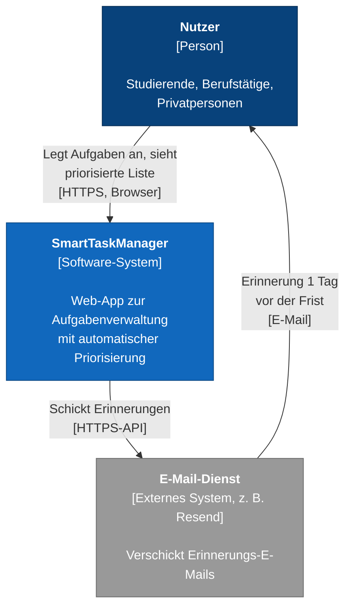
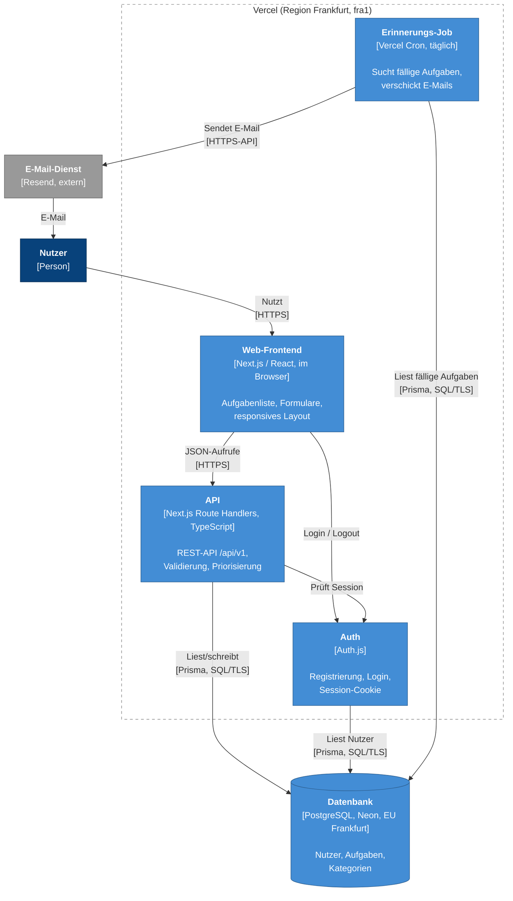
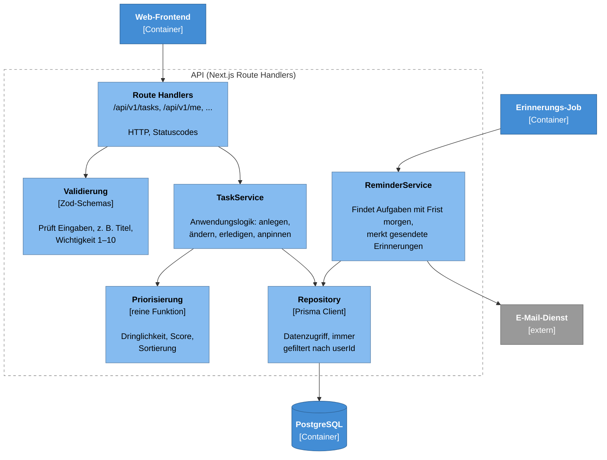
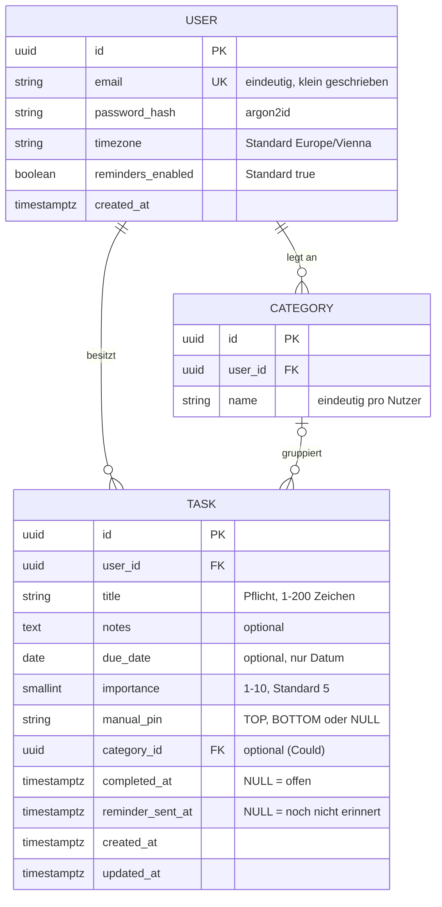
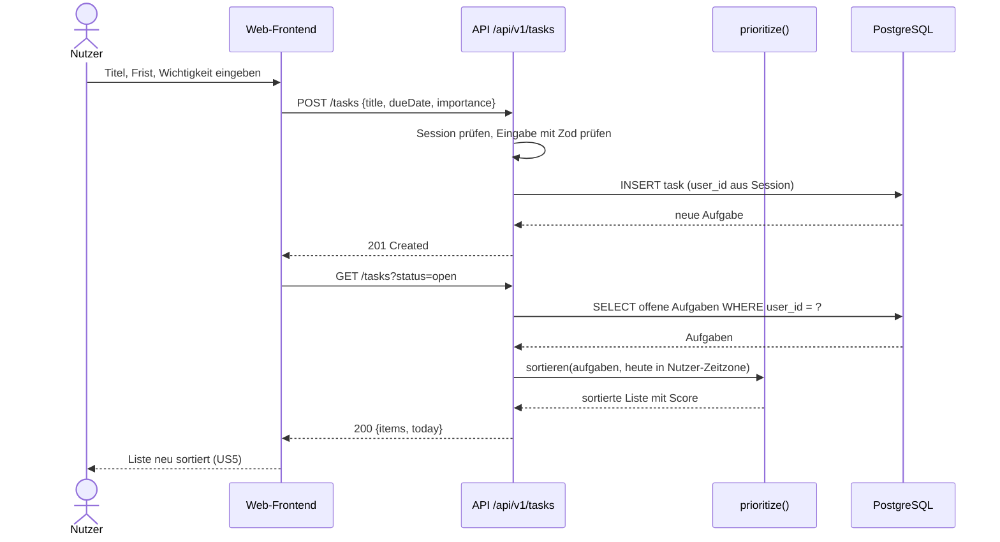
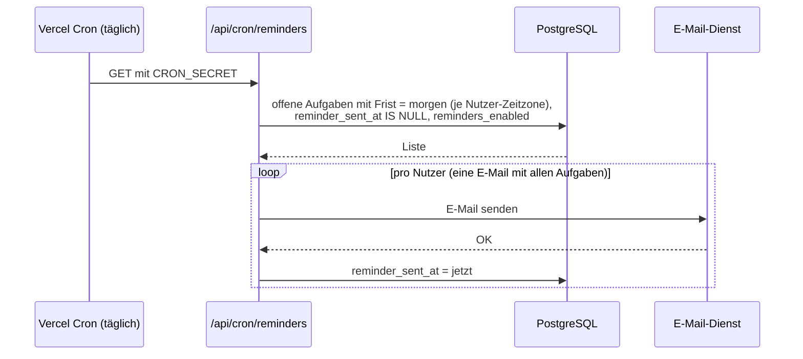

# Softwarearchitektur – SmartTaskManager

Dieses Dokument beschreibt die Architektur des SmartTaskManagers. Grundlage sind die Anforderungen aus [requirements.md](requirements.md). Die Architektur wurde mit AI-Unterstützung erarbeitet (siehe [Kapitel 2](#2-ai-einsatz-für-architekturvorschläge)) und danach kritisch geprüft (siehe [Kapitel 10](#10-kritische-prüfung-der-ai-generierten-architektur)).

> **Status:** Vorschlag. Alle Entscheidungen sind als ADRs mit Status *Vorgeschlagen* dokumentiert und müssen vom Team bestätigt werden.

## Inhalt

1. [Ziele und Rahmenbedingungen](#1-ziele-und-rahmenbedingungen)
2. [AI-Einsatz für Architekturvorschläge](#2-ai-einsatz-für-architekturvorschläge)
3. [Untersuchte Architekturvarianten](#3-untersuchte-architekturvarianten)
4. [Gewählte Architektur](#4-gewählte-architektur)
5. [Technologieauswahl und Begründung](#5-technologieauswahl-und-begründung)
6. [Architekturdiagramme (C4)](#6-architekturdiagramme-c4)
7. [Datenmodell](#7-datenmodell)
8. [Schnittstellen / API-Design](#8-schnittstellen--api-design)
9. [Wichtige Abläufe](#9-wichtige-abläufe)
10. [Kritische Prüfung der AI-generierten Architektur](#10-kritische-prüfung-der-ai-generierten-architektur)
11. [Architecture Decision Records](#11-architecture-decision-records)
12. [Offene Punkte](#12-offene-punkte)

---

## 1. Ziele und Rahmenbedingungen

### Architekturtreiber

Diese Anforderungen beeinflussen die Architektur am stärksten:

| Treiber | Quelle | Was das für die Architektur bedeutet |
|---|---|---|
| Kleines MVP, kleines Team, Uni-Zeitrahmen | MVP-Scope | Einfache Architektur, wenig Betriebsaufwand, eine Codebasis |
| Deployment über GitHub → CD → Vercel | README, Phase 2 | Technik muss gut auf Vercel laufen |
| Passwörter gehasht speichern | NF3 | Bewährte Auth-Bibliothek, sicheres Hash-Verfahren |
| Liste lädt in unter 2 Sekunden | NF2 | Wenige Netzwerk-Sprünge, DB nahe am Server, Index auf Nutzer |
| Browser und Handy | NF4 | Responsive Web-App statt nativer App |
| DSGVO | NF5, offener Punkt #7 | Daten in der EU, Konto löschbar, möglichst wenige Daten |
| Erinnerung 1 Tag vor Frist | F6 | Ein Hintergrund-Job ist nötig (zeitgesteuert) |
| Sortierung ändert sich mit dem Datum | F4 | Score darf nicht „einfrieren“, sondern muss aktuell berechnet werden |

### Bewusst nicht im Fokus

- Teamfunktionen und Kalender-Anbindung (*Won't*)
- Native Handy-App (*Could*)
- Sehr viele Nutzer gleichzeitig – das MVP ist für wenige hundert Nutzer gedacht

## 2. AI-Einsatz für Architekturvorschläge

| Tool | Zweck |
|---|---|
| Claude Code (Claude Opus) | Repository lesen, Architekturvarianten vorschlagen, Technologien vergleichen, Diagramme (Mermaid) und Dokumente erstellen, Hosting-Preise recherchieren |

**Vorgehen:**

1. Die AI hat `README.md` und `docs/requirements.md` gelesen.
2. **Prompt (sinngemäß):** „Erstelle anhand dieses Repos eine nachvollziehbare Softwarearchitektur: mindestens zwei Varianten, Technologieauswahl mit Begründung, C4-Diagramm, Datenmodell, API-Design, mindestens zwei ADRs, kritische Prüfung, Hosting-Vergleich.“
3. Die AI hat drei Varianten vorgeschlagen (Kapitel 3) und eine empfohlen.
4. Die AI-Vorschläge wurden danach Punkt für Punkt geprüft. Was dabei auffiel und geändert wurde, steht in [Kapitel 10](#10-kritische-prüfung-der-ai-generierten-architektur).

**Grundsatz wie in Phase 1:** Die AI liefert Vorschläge. Die Entscheidung trifft das Team. Deshalb haben alle ADRs den Status *Vorgeschlagen*.

## 3. Untersuchte Architekturvarianten

### Variante A – Full-Stack-Monolith mit Next.js (serverless)

Eine einzige Next.js-Anwendung enthält Frontend **und** Backend (Route Handlers als REST-API). Sie läuft auf Vercel. Die Daten liegen in einer gemanagten PostgreSQL-Datenbank (z. B. Neon) in der EU.

```
Browser ──HTTPS──▶ Next.js auf Vercel (UI + /api/v1) ──▶ PostgreSQL (Neon, Frankfurt)
                     └─ Vercel Cron (täglich) ──▶ E-Mail-Dienst
```

### Variante B – Getrenntes Frontend und Backend (klassisch, 3 Schichten)

Eine Single-Page-App (React + Vite) als statische Seite. Ein eigenes Backend (z. B. Spring Boot oder Node/Express) als Container. Dazu PostgreSQL.

```
Browser ──▶ React-SPA (statisch, CDN)
        └──HTTPS/JSON──▶ REST-Backend (Container, z. B. Render/Hetzner) ──▶ PostgreSQL
                            └─ Scheduler im Backend ──▶ E-Mail-Dienst
```

### Variante C – Backend-as-a-Service (Supabase)

Das Frontend spricht direkt mit Supabase. Supabase liefert Login, Datenbank und API. Zugriffsschutz läuft über Row Level Security (RLS) in der Datenbank. Logik wie Erinnerungen läuft in Edge Functions.

```
Browser (React) ──▶ Supabase (Auth + PostgreSQL + auto-generierte API + Edge Functions)
```

### Vergleich

Bewertung: ++ sehr gut, + gut, o neutral, − schlecht

| Kriterium | A: Next.js-Monolith | B: Getrenntes Front-/Backend | C: Supabase (BaaS) |
|---|---|---|---|
| Aufwand für das MVP | ++ eine Codebasis, eine Sprache | − zwei Projekte, zwei Deployments | ++ sehr wenig Backend-Code |
| Passt zu Phase 2 (GitHub → Vercel) | ++ Vercel ist für Next.js gemacht | o Frontend ja, Backend braucht anderen Host | + Frontend auf Vercel, DB bei Supabase |
| Kontrolle über Priorisierungslogik | ++ im eigenen Code, gut testbar | ++ im eigenen Code | o Logik in SQL/RLS oder Edge Functions verteilt |
| Testbarkeit | + Unit-Tests für Logik, API-Tests | ++ klar getrennte Schichten | − Logik in DB-Regeln schwer zu testen |
| Lernwert für Software Engineering | + | ++ klassische Schichten | − viel „Magie“ des Anbieters |
| Betrieb / Kosten MVP | ++ Gratis-Stufen reichen | o Container kostet meist Geld oder schläft ein | + Gratis-Stufe, aber Projekt pausiert nach 1 Woche Inaktivität |
| Anbieterbindung (Lock-in) | o Vercel-Funktionen (Cron), aber Next.js läuft auch im Container | ++ gering | − hoch (Auth, RLS, API) |
| Skalierung später | + automatisch (serverless) | + gut, aber selbst einzustellen | + gut |
| DSGVO / EU-Daten | + EU-Regionen wählbar | ++ voll in EU möglich (z. B. Hetzner) | + EU-Region wählbar |

### Ergebnis

**Variante A wird empfohlen.** Sie ist für ein kleines Team und ein kleines MVP am einfachsten, passt direkt zum geplanten Vercel-Deployment und hält die wichtigste Logik (Priorisierung) im eigenen, testbaren Code.

Variante B wäre die bessere Wahl, wenn das Backend in einer anderen Sprache (z. B. Java) geschrieben werden soll oder später eine native Handy-App dazukommt. Durch eine klare REST-API (Kapitel 8) bleibt dieser Weg offen.

Variante C spart am meisten Code, verteilt aber die Kernlogik auf Datenbank-Regeln und erzeugt starke Abhängigkeit vom Anbieter.

Die Entscheidung ist in [ADR-001](adr/0001-nextjs-monolith.md) festgehalten.

## 4. Gewählte Architektur

**Stil:** Modularer Monolith. Eine Next.js-Anwendung mit klar getrennten Modulen. Die Logik ist von Framework und Datenbank getrennt, damit sie einfach getestet werden kann.

### Schichten im Code

| Schicht | Aufgabe | Beispiel |
|---|---|---|
| UI (React) | Anzeigen, Eingaben | `app/(app)/tasks/page.tsx` |
| API (Route Handlers) | HTTP, Statuscodes, Auth-Prüfung | `app/api/v1/tasks/route.ts` |
| Validierung | Eingaben prüfen | `lib/validation/task.ts` (Zod) |
| Anwendungslogik | Use Cases | `lib/tasks/task-service.ts` |
| Domänenlogik | Priorisierung als reine Funktion | `lib/tasks/prioritize.ts` |
| Datenzugriff | DB-Abfragen, immer nach `userId` gefiltert | `lib/db/task-repository.ts` (Prisma) |

### Vorgeschlagene Ordnerstruktur

```
smarttaskmanager/
├── app/
│   ├── (auth)/login, register     # Seiten für Login/Registrierung
│   ├── (app)/tasks                # Hauptseite: priorisierte Liste
│   └── api/
│       ├── auth/[...nextauth]     # Auth.js
│       ├── v1/tasks/...           # REST-API Aufgaben
│       ├── v1/me/...              # Konto, Löschen, Export
│       └── cron/reminders         # täglicher Erinnerungs-Job
├── lib/
│   ├── tasks/prioritize.ts        # Score + Sortierung (reine Funktion)
│   ├── tasks/task-service.ts
│   ├── reminders/reminder-service.ts
│   ├── validation/
│   └── db/                        # Prisma Client, Repositories
├── prisma/schema.prisma
├── tests/                         # Unit- und API-Tests
└── vercel.json                    # Cron-Konfiguration, Region
```

### Querschnittsthemen

| Thema | Lösung |
|---|---|
| Authentifizierung | Auth.js mit E-Mail + Passwort, Session als HTTP-only-Cookie ([ADR-004](adr/0004-auth-mit-authjs.md)) |
| Autorisierung | Jede Abfrage filtert nach `userId` aus der Session. Fremde Aufgaben → `404` (nicht `403`, damit keine IDs erraten werden können) |
| Passwörter | argon2id (alternativ bcrypt), nie im Klartext, nie in Logs (NF3) |
| Validierung | Zod-Schemas, dieselben Regeln im Frontend und in der API |
| Fehler | Einheitliches JSON-Fehlerformat (Kapitel 8) |
| Zeitzonen | Frist als reines Datum; „heute“ wird in der Zeitzone des Nutzers berechnet |
| Logging | Vercel Runtime Logs, keine personenbezogenen Daten im Log |
| Tests | Vitest für `prioritize.ts` und Services, API-Tests gegen Test-Datenbank |
| DSGVO | EU-Region, Konto löschen (`DELETE /me`), Datenexport, nur nötige Daten speichern |

## 5. Technologieauswahl und Begründung

| Bereich | Wahl | Begründung | Alternativen |
|---|---|---|---|
| Sprache | **TypeScript** | Eine Sprache für Frontend und Backend; Typen fangen Fehler früh | JavaScript (keine Typen), Java (zweite Sprache nötig) |
| Framework | **Next.js (App Router)** | UI und API in einem Projekt; offizielle, beste Unterstützung auf Vercel | Remix, SvelteKit, React + Express |
| UI | **React + Tailwind CSS** | Schnell responsive Layouts bauen (NF4); große Community | CSS Modules, MUI |
| Datenbank | **PostgreSQL** | Relationale Daten (Nutzer → Aufgaben), Constraints (z. B. Wichtigkeit 1–10), Standard und portabel ([ADR-002](adr/0002-postgresql-mit-prisma.md)) | MongoDB, SQLite |
| DB-Anbieter | **Neon (Region Frankfurt)** | Gratis-Stufe ohne automatisches Löschen, serverless, direkte Vercel-Integration | Supabase, Vercel-Postgres-Integrationen, Render Postgres |
| Datenzugriff | **Prisma ORM** | Typsichere Abfragen, Migrationen im Repo, Schema als Dokumentation | Drizzle ORM, reines SQL |
| Auth | **Auth.js (Credentials)** | Bewährt, Sessions über sichere Cookies, Daten bleiben in unserer DB | Clerk, Supabase Auth, eigene Lösung |
| Validierung | **Zod** | Ein Schema für Frontend und API, gute TypeScript-Typen | Yup, Joi |
| Hintergrund-Job | **Vercel Cron** (1× täglich) | Kein eigener Server nötig; reicht für „1 Tag vor Frist“ ([ADR-005](adr/0005-erinnerungen-per-cron.md)) | GitHub Actions Schedule, Upstash QStash |
| E-Mail | **Resend** | Einfache HTTPS-API, Gratis-Stufe reicht für das MVP | Postmark, SMTP-Server |
| Tests | **Vitest + Playwright** | Schnelle Unit-Tests; Playwright für einen End-to-End-Test pro Hauptanwendungsfall | Jest, Cypress |
| CI/CD | **GitHub Actions + Vercel** | Tests bei jedem Pull Request, automatisches Deployment (Phase 2) | GitLab CI |

## 6. Architekturdiagramme (C4)

Die Diagramme sind als Mermaid-Quellen im Ordner [`docs/diagrams/`](diagrams/) abgelegt und zusätzlich als SVG exportiert. GitHub zeigt die Mermaid-Blöcke unten direkt als Grafik an.

### Ebene 1 – Systemkontext





### Ebene 2 – Container





### Ebene 3 – Komponenten der API





## 7. Datenmodell





### Tabellen im Detail

**`users`**

| Feld | Typ | Regel | Anforderung |
|---|---|---|---|
| `id` | UUID | Primärschlüssel | – |
| `email` | text | Pflicht, eindeutig, klein geschrieben gespeichert | F1, US1 |
| `password_hash` | text | argon2id-Hash, nie Klartext | NF3 |
| `timezone` | text | IANA-Zeitzone, Standard `Europe/Vienna` | F4 („heute“), F6 |
| `reminders_enabled` | boolean | Standard `true`, abschaltbar | F6, NF5 |
| `created_at` | timestamptz | automatisch | – |

**`tasks`**

| Feld | Typ | Regel | Anforderung |
|---|---|---|---|
| `id` | UUID | Primärschlüssel | – |
| `user_id` | UUID | FK → `users.id`, `ON DELETE CASCADE` | F1, NF5 |
| `title` | text | Pflicht, nach `trim()` 1–200 Zeichen | US2 |
| `notes` | text | optional | – |
| `due_date` | date | optional; nur Datum, keine Uhrzeit | F3, US3 |
| `importance` | smallint | `CHECK (importance BETWEEN 1 AND 10)`, Standard 5 | F3, US4, offener Punkt #10 |
| `manual_pin` | enum `TOP` / `BOTTOM` | `NULL` = automatische Sortierung | F8, US10, offener Punkt #8 |
| `category_id` | UUID | optional, FK → `categories.id`, `ON DELETE SET NULL` | F7 (Could) |
| `completed_at` | timestamptz | `NULL` = offen; Zeitpunkt = erledigt; zurücksetzen möglich | F5, US6 |
| `reminder_sent_at` | timestamptz | verhindert doppelte Erinnerungen | F6 |
| `created_at` | timestamptz | für Gleichstand „älteste zuerst“ | F4 |
| `updated_at` | timestamptz | automatisch | – |

**`categories`** (Could, F7): `id`, `user_id` (FK, `ON DELETE CASCADE`), `name` (eindeutig pro Nutzer).

### Indizes

| Index | Zweck |
|---|---|
| `tasks (user_id, completed_at)` | Offene Aufgaben eines Nutzers schnell laden (NF2) |
| `tasks (due_date) WHERE completed_at IS NULL AND reminder_sent_at IS NULL` | Erinnerungs-Job findet fällige Aufgaben schnell |
| `users (email)` unique | Login |

### Was bewusst **nicht** gespeichert wird

- **Kein Score in der Datenbank.** Der Score hängt vom heutigen Datum ab. Ein gespeicherter Score wäre am nächsten Tag falsch. Er wird bei jeder Abfrage berechnet ([ADR-003](adr/0003-score-zur-laufzeit-berechnen.md)).
- **Kein Name, keine Telefonnummer.** Für die Funktion reicht die E-Mail (Datensparsamkeit, NF5).
- **Keine Session-Tabelle.** Auth.js nutzt verschlüsselte Session-Cookies (JWT-Strategie).

### Priorisierung (Umsetzung der Regel aus requirements.md, Kapitel 7)

```ts
// lib/tasks/prioritize.ts – reine Funktion, ohne DB und ohne Framework
urgency(task, today) =
  task.dueDate == null            ? null
  : daysUntil(task.dueDate, today) <= 0 ? 10            // heute oder überfällig
  : max(1, 10 - daysUntil(task.dueDate, today))

score(task, today) = 0.6 * task.importance + 0.4 * urgency(task, today)

Sortierung:
  1. manualPin = TOP           (neueste Anpinnung zuerst)
  2. mit Frist                 nach Score absteigend
  3. ohne Frist                nach Wichtigkeit absteigend
  4. manualPin = BOTTOM
  Gleichstand: frühere Frist zuerst, dann älteste Aufgabe zuerst
```

`today` wird in der Zeitzone des Nutzers bestimmt und als Parameter übergeben. So ist die Funktion einfach mit festen Daten testbar. Die Gewichte (0,6 / 0,4) stehen in einer Konfiguration, damit das Team sie ändern kann. Zu einem Problem mit dieser Regel siehe [Kapitel 10, Punkt 4](#10-kritische-prüfung-der-ai-generierten-architektur).

## 8. Schnittstellen / API-Design

### Grundregeln

- REST mit JSON, Basis-Pfad **`/api/v1`** (Version im Pfad, damit spätere Änderungen möglich sind)
- Authentifizierung über das Session-Cookie von Auth.js (`HttpOnly`, `Secure`, `SameSite=Lax`)
- Datumsfelder: `due_date` als `YYYY-MM-DD`, Zeitpunkte als ISO 8601 in UTC
- Feldnamen in `camelCase`
- Fehler immer im gleichen Format (angelehnt an RFC 9457 „Problem Details“)

Die Web-App nutzt selbst diese API. Dadurch ist sie testbar und könnte später auch von einer Handy-App genutzt werden.

### Endpunkte

**Konto und Login**

| Methode | Pfad | Zweck | Erfolg | Anforderung |
|---|---|---|---|---|
| `POST` | `/api/v1/auth/register` | Konto anlegen (E-Mail, Passwort) | `201` | F1 |
| `POST` | `/api/auth/callback/credentials` | Login (von Auth.js bereitgestellt) | `200` + Cookie | F1 |
| `POST` | `/api/auth/signout` | Logout (von Auth.js bereitgestellt) | `200` | F1 |
| `GET` | `/api/v1/me` | Eigenes Profil und Einstellungen | `200` | – |
| `PATCH` | `/api/v1/me` | Einstellungen ändern (Zeitzone, Erinnerungen an/aus) | `200` | F6 |
| `DELETE` | `/api/v1/me` | Konto und alle Daten löschen | `204` | NF5 |
| `GET` | `/api/v1/me/export` | Alle eigenen Daten als JSON | `200` | NF5 |

**Aufgaben**

| Methode | Pfad | Zweck | Erfolg | Anforderung |
|---|---|---|---|---|
| `GET` | `/api/v1/tasks?status=open\|done&categoryId=` | Liste, **bereits priorisiert sortiert** | `200` | F4, F5, F7 |
| `POST` | `/api/v1/tasks` | Aufgabe anlegen | `201` | F2, F3 |
| `GET` | `/api/v1/tasks/{id}` | Eine Aufgabe | `200` | F2 |
| `PATCH` | `/api/v1/tasks/{id}` | Felder ändern (Titel, Frist, Wichtigkeit, `manualPin`, Kategorie) | `200` | F2, F3, F8 |
| `DELETE` | `/api/v1/tasks/{id}` | Aufgabe löschen | `204` | F2 |
| `POST` | `/api/v1/tasks/{id}/complete` | Als erledigt markieren | `200` | F5 |
| `DELETE` | `/api/v1/tasks/{id}/complete` | Erledigt rückgängig machen | `200` | F5, US6 |

**Kategorien (Could, F7):** `GET/POST /api/v1/categories`, `PATCH/DELETE /api/v1/categories/{id}`

**Intern:** `GET /api/cron/reminders` – nur für Vercel Cron, geschützt durch `Authorization: Bearer <CRON_SECRET>`.

### Beispiele

**Aufgabe anlegen** – nur der Titel ist Pflicht (US2, NF1):

```http
POST /api/v1/tasks
Content-Type: application/json

{ "title": "Prüfung lernen", "dueDate": "2026-11-12", "importance": 9 }
```

```http
HTTP/1.1 201 Created
Location: /api/v1/tasks/7f3c...

{
  "id": "7f3c...",
  "title": "Prüfung lernen",
  "notes": null,
  "dueDate": "2026-11-12",
  "importance": 9,
  "manualPin": null,
  "categoryId": null,
  "completedAt": null,
  "createdAt": "2026-11-09T19:10:00Z",
  "updatedAt": "2026-11-09T19:10:00Z",
  "priority": { "urgency": 7, "score": 8.2, "overdue": false }
}
```

**Priorisierte Liste:**

```http
GET /api/v1/tasks?status=open
```

```json
{
  "items": [
    { "id": "...", "title": "Prüfung lernen", "dueDate": "2026-11-12", "importance": 9,
      "priority": { "urgency": 7, "score": 8.2, "overdue": false } },
    { "id": "...", "title": "Abgabe Übungsblatt", "dueDate": "2026-11-10", "importance": 6,
      "priority": { "urgency": 9, "score": 7.2, "overdue": false } }
  ],
  "today": "2026-11-09"
}
```

Das Feld `priority` wird vom Server berechnet und ist nur lesbar. Der Server liefert auch `today` mit, damit Frontend und Server dasselbe „heute“ verwenden.

**Manuell nach oben setzen (US10):**

```http
PATCH /api/v1/tasks/7f3c...
{ "manualPin": "TOP" }      // zurücksetzen mit { "manualPin": null }
```

**Fehlerformat:**

```json
HTTP/1.1 422 Unprocessable Content
{
  "type": "https://smarttaskmanager.app/errors/validation",
  "title": "Eingabe ungültig",
  "status": 422,
  "errors": [ { "field": "importance", "message": "Muss zwischen 1 und 10 liegen." } ]
}
```

### Statuscodes

| Code | Bedeutung |
|---|---|
| `200` / `201` / `204` | Erfolg / angelegt / ohne Inhalt |
| `400` | JSON kaputt |
| `401` | Nicht eingeloggt |
| `404` | Nicht gefunden **oder gehört einem anderen Nutzer** |
| `409` | E-Mail schon registriert |
| `422` | Validierungsfehler (z. B. leerer Titel, Wichtigkeit 11) |
| `429` | Zu viele Login-Versuche |

## 9. Wichtige Abläufe

### Aufgabe anlegen und sortierte Liste sehen (UC1, UC2)



### Erinnerung verschicken (UC4, F6)



Wenn die Frist einer Aufgabe geändert wird, setzt der Server `reminder_sent_at` wieder auf `NULL`. So gibt es für die neue Frist wieder eine Erinnerung.

## 10. Kritische Prüfung der AI-generierten Architektur

Die erste AI-Version wurde Punkt für Punkt gegen die Anforderungen geprüft. Gefundene Schwächen und die Reaktion darauf:

| # | Punkt | Problem | Reaktion |
|---|---|---|---|
| 1 | **Überdimensionierung** | AI-Vorschläge für Task-Apps enthalten oft Microservices, Redis-Cache, Message-Queue oder Kubernetes. Für ein MVP mit wenigen hundert Nutzern ist das zu viel Aufwand und Betrieb. | Bewusst ein Monolith mit einer Datenbank. Erweiterungen erst, wenn Messungen sie nötig machen. |
| 2 | **Score speichern** | Naheliegend wäre, den Score als Spalte zu speichern und danach zu sortieren. Der Score ändert sich aber jeden Tag (Frist rückt näher). Gespeicherte Werte wären veraltet. | Score wird zur Laufzeit berechnet ([ADR-003](adr/0003-score-zur-laufzeit-berechnen.md)). |
| 3 | **Zeitzonen** | „Frist heute“ ist nicht eindeutig: Der Server läuft in UTC, die Nutzer z. B. in Wien. Kurz nach Mitternacht wäre „heute“ sonst falsch. | `due_date` als reines Datum, Zeitzone pro Nutzer gespeichert, `today` als Parameter. |
| 4 | **Widerspruch in der Priorisierungsregel** | In requirements.md steht „Wichtigkeit ist schwerer gewichtet als Frist“. Die Sortierreihenfolge stellt aber **alle** Aufgaben ohne Frist unter alle Aufgaben mit Frist. Im Beispiel landet „Buch lesen“ (Wichtigkeit 7) unter „Wäsche waschen“ (Wichtigkeit 3). Eine Aufgabe mit Wichtigkeit 10 ohne Frist stünde sogar unter einer Aufgabe mit Wichtigkeit 1 und Frist in 30 Tagen. | Regel wie beschlossen umgesetzt, aber als **offener Punkt** an das Team gemeldet. Vorschlag: Aufgaben ohne Frist mit Dringlichkeit 1 in denselben Score aufnehmen. Durch die reine Funktion `prioritize()` ist eine Änderung nur eine Stelle im Code. |
| 5 | **Cron-Genauigkeit** | Auf dem Gratis-Plan von Vercel laufen Cron-Jobs nur einmal am Tag und nicht minutengenau. | Reicht für „1 Tag vor der Frist“. Für genaue Uhrzeiten später QStash oder ähnliches ([ADR-005](adr/0005-erinnerungen-per-cron.md)). |
| 6 | **Kaltstarts und DB-Verbindungen** | Serverless-Funktionen öffnen viele kurze DB-Verbindungen; die Gratis-DB „schläft“ ein. Das kann die 2-Sekunden-Grenze (NF2) gefährden. | Connection-Pooler von Neon nutzen, Funktion und DB in derselben Region (Frankfurt). NF2 im Deployment messen. |
| 7 | **DSGVO trotz EU-Region** | Vercel, Neon und Resend sind US-Firmen. Die EU-Region allein löst die DSGVO-Frage nicht. | Auftragsverarbeitungsverträge (DPA) prüfen, Anbieter in Datenschutzerklärung nennen. Rein europäische Alternative in [hosting.md](hosting.md). |
| 8 | **Anbieterbindung** | Vercel Cron und die Vercel-Integration binden an Vercel. | Nur Standard-Teile verwenden: Next.js läuft auch als Docker-Container, Prisma + PostgreSQL sind portabel, der Cron-Endpunkt ist ein normaler HTTP-Aufruf. |
| 9 | **Sicherheit beim Login** | Ein eigenes Login „von Hand“ zu bauen ist fehleranfällig. Außerdem fehlte im ersten Entwurf ein Schutz gegen Passwort-Raten. | Auth.js statt Eigenbau, Rate Limiting auf Login, sichere Cookies ([ADR-004](adr/0004-auth-mit-authjs.md)). |
| 10 | **Zugriff auf fremde Daten** | Bei REST-APIs mit IDs in der URL ist das häufigste Sicherheitsproblem, dass man fremde Objekte abrufen kann (IDOR). | Jede Abfrage im Repository filtert verpflichtend nach `userId`; API-Test dafür. |
| 11 | **Gratis-Stufe ≠ kommerziell** | Vercel Hobby ist nur für nicht-kommerzielle Nutzung erlaubt. | Für das Uni-Projekt passend; bei echtem Produkt Wechsel auf Pro (siehe [hosting.md](hosting.md)). |
| 12 | **Server Actions vs. REST** | Next.js bietet Server Actions, die weniger Code brauchen. Die AI hat beide Wege genannt. | REST-API gewählt: besser testbar, dokumentierbar und für eine spätere Handy-App nutzbar. Mehr Code wird bewusst in Kauf genommen. |

### Fazit zur AI-Unterstützung

- **Hilfreich:** Schneller Überblick über Varianten, Vergleichstabellen, Diagramm-Code, Struktur der Dokumente.
- **Nicht verlässlich:** Preise und Limits von Anbietern ändern sich oft. Sie wurden deshalb im Web nachgeprüft (Stand siehe hosting.md).
- **Fehlender Kontext:** Ohne den Hinweis auf Phase 2 (Vercel) und die Teamgröße wären größere Architekturen vorgeschlagen worden.
- **Wichtigster Fund:** Punkt 4 – ein Widerspruch in den eigenen Anforderungen, der erst beim Umsetzen in Code sichtbar wurde.

## 11. Architecture Decision Records

| ADR | Titel | Status |
|---|---|---|
| [ADR-001](adr/0001-nextjs-monolith.md) | Full-Stack-Monolith mit Next.js statt getrenntem Front- und Backend | Vorgeschlagen |
| [ADR-002](adr/0002-postgresql-mit-prisma.md) | PostgreSQL mit Prisma als Datenbank | Vorgeschlagen |
| [ADR-003](adr/0003-score-zur-laufzeit-berechnen.md) | Prioritäts-Score zur Laufzeit berechnen statt speichern | Vorgeschlagen |
| [ADR-004](adr/0004-auth-mit-authjs.md) | Authentifizierung mit Auth.js (E-Mail + Passwort) | Vorgeschlagen |
| [ADR-005](adr/0005-erinnerungen-per-cron.md) | Erinnerungen per täglichem Cron-Job und E-Mail | Vorgeschlagen |

Alle ADRs: [docs/adr/](adr/README.md)

## 12. Offene Punkte

| # | Frage | Vorschlag |
|---|---|---|
| A1 | Priorisierungsregel: Sollen Aufgaben ohne Frist wirklich immer unten stehen? (Kapitel 10, Punkt 4) | Team entscheidet; Code ist darauf vorbereitet |
| A2 | Manuelle Priorität: Reicht „nach oben / nach unten anpinnen“? | `manualPin = TOP/BOTTOM` als MVP-Lösung |
| A3 | Erinnerung nur per E-Mail oder auch im Browser (Push)? | MVP: E-Mail + Hinweis in der App; Push später |
| A4 | Soll die Datenhaltung vollständig in der EU bei einem EU-Anbieter liegen? | Siehe Vergleich in [hosting.md](hosting.md) |
| A5 | Bestätigung der E-Mail-Adresse bei der Registrierung? | Nicht im MVP, aber sinnvoll, sobald Erinnerungs-E-Mails verschickt werden |
