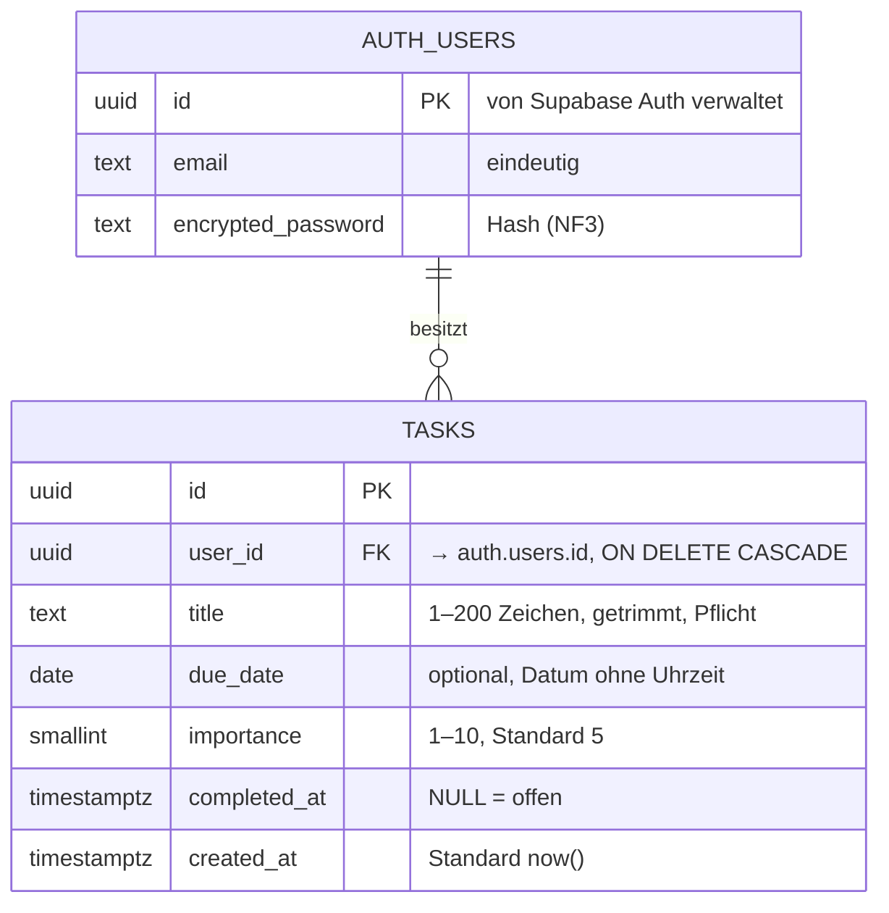

# Datenmodell – SmartTaskManager

> Stand: 23.11.2026. Datenbank: PostgreSQL bei Supabase (EU-Region), siehe [architecture.md](architecture.md).

## Grundsätze

- **Datensparsamkeit (NF5):** Es gibt keine eigene Profil-Tabelle; die eigene Tabelle `tasks` enthält außer der Zuordnung `user_id` keine personenbezogenen Daten. Supabase Auth speichert im Schema `auth` die E-Mail und den Passwort-Hash (`auth.users`) sowie technische Sitzungs- und Protokolldaten, u. a. IP-Adresse und Browser-Kennung (`auth.sessions`, `auth.audit_log_entries`). Die Protokolleinträge hängen nicht per Fremdschlüssel am Nutzer und werden beim Löschen des Kontos **nicht** automatisch mitgelöscht – siehe requirements.md #17.
- **Abgeleitete Werte werden nicht gespeichert:** Dringlichkeit, Score und „überfällig“ hängen vom heutigen Datum des Nutzers ab und werden bei jeder Abfrage berechnet (siehe [api.md](api.md) und requirements.md Kapitel 7). Ein gespeicherter Score wäre am nächsten Tag falsch.
- **Schema nur für das MVP:** Erweiterungen für Should- und Could-Funktionen sind unten beschrieben, werden aber erst mit der jeweiligen Funktion per Migration angelegt.

## ER-Diagramm



`auth.users` gehört Supabase Auth und wird nicht selbst verändert. Die Felder oben sind nur die für uns relevanten.

## Tabelle `public.tasks`

| Spalte | Typ | Pflicht | Standard | Regel | Anforderung |
|---|---|---|---|---|---|
| `id` | `uuid` | ja | `gen_random_uuid()` | Primärschlüssel | – |
| `user_id` | `uuid` | ja | – | Fremdschlüssel auf `auth.users(id)`, `ON DELETE CASCADE` | F1, F9 |
| `title` | `text` | ja | – | getrimmt gespeichert, 1–200 Zeichen | F2, US2 |
| `due_date` | `date` | nein | `NULL` | Datum ohne Uhrzeit; `NULL` = keine Frist | F3, US3 |
| `importance` | `smallint` | ja | `5` | 1 bis 10 | F3, US4 |
| `completed_at` | `timestamptz` | nein | `NULL` | `NULL` = offen, sonst Zeitpunkt des Abhakens | F5, US6 |
| `created_at` | `timestamptz` | ja | `now()` | für Gleichstand in der Sortierung | F4 |

### Entscheidungen

- **`completed_at` statt `done boolean`:** Ein Feld deckt „offen/erledigt“ ab und liefert gleichzeitig die Reihenfolge für die Ansicht „Erledigt“ (zuletzt erledigt zuerst). Rückgängig machen = auf `NULL` setzen.
- **`due_date` als `date`, nicht `timestamptz`:** Die Frist ist laut requirements.md ein Datum ohne Uhrzeit. Ein Zeitstempel würde Zeitzonenfehler einführen.
- **Titel-Länge 200 Zeichen:** In den Anforderungen nicht festgelegt; im Design gesetzt, damit die Liste lesbar bleibt und die Eingabe begrenzt ist. Die API speichert den Titel getrimmt; die Datenbank erzwingt das zusätzlich (`title = btrim(title)`).
- **`ON DELETE CASCADE`:** Wird ein Konto gelöscht (F9), löscht die Datenbank alle Aufgaben automatisch mit. Kein eigener Löschcode für Aufgaben nötig, keine verwaisten Daten (NF5).

## SQL (erste Migration)

```sql
create table public.tasks (
  id           uuid primary key default gen_random_uuid(),
  user_id      uuid not null references auth.users (id) on delete cascade,
  title        text not null check (title = btrim(title) and char_length(title) between 1 and 200),
  due_date     date,
  importance   smallint not null default 5 check (importance between 1 and 10),
  completed_at timestamptz,
  created_at   timestamptz not null default now()
);

-- Offene bzw. erledigte Aufgaben eines Nutzers schnell finden (NF2)
create index tasks_user_completed_idx on public.tasks (user_id, completed_at);

-- Rechte: nur angemeldete Nutzer, anonymer Zugriff ausgeschlossen
revoke all on public.tasks from anon;
grant select, insert, update, delete on public.tasks to authenticated;

-- Zugriffsregeln (zweite Schutzschicht, siehe architecture.md)
alter table public.tasks enable row level security;

create policy "Nutzer sieht eigene Aufgaben"
  on public.tasks for select to authenticated
  using (user_id = (select auth.uid()));

create policy "Nutzer legt eigene Aufgaben an"
  on public.tasks for insert to authenticated
  with check (user_id = (select auth.uid()));

create policy "Nutzer ändert eigene Aufgaben"
  on public.tasks for update to authenticated
  using (user_id = (select auth.uid()))
  with check (user_id = (select auth.uid()));

create policy "Nutzer löscht eigene Aufgaben"
  on public.tasks for delete to authenticated
  using (user_id = (select auth.uid()));
```

- Die Prüfungen (`check`) doppeln bewusst die Validierung in der API: Selbst bei einem Fehler im Servercode können keine ungültigen Daten gespeichert werden.
- `to authenticated` beschränkt die Regeln auf angemeldete Nutzer; Rechte werden explizit vergeben statt sich auf Voreinstellungen des Projekts zu verlassen.
- `(select auth.uid())` statt `auth.uid()`: Supabase empfiehlt diese Schreibweise, weil die Funktion dann einmal pro Abfrage statt einmal pro Zeile ausgewertet wird.
- Wie kommt `auth.uid()` an den Nutzer? Der Server ruft die Datenbank mit `supabase-js` und dem Zugriffstoken (JWT) des Nutzers aus dem Session-Cookie auf. PostgREST prüft das Token und stellt die Nutzer-ID für die Abfrage bereit; `auth.uid()` liest sie aus.

## Geplante Erweiterungen

| Funktion | Änderung | Wann |
|---|---|---|
| F8 Aufgaben anpinnen (Should) | Spalte `pinned boolean not null default false` | mit Umsetzung von F8 |
| F7 Kategorien (Could) | Tabelle `categories (id, user_id, name)`, Spalte `tasks.category_id` (optional, Fremdschlüssel) | nur falls F7 umgesetzt wird |
| F6 Erinnerung in der App (Should) | keine – wird aus `due_date` berechnet | – |
| F10 Passwort zurücksetzen (Should) | keine – übernimmt Supabase Auth | – |
